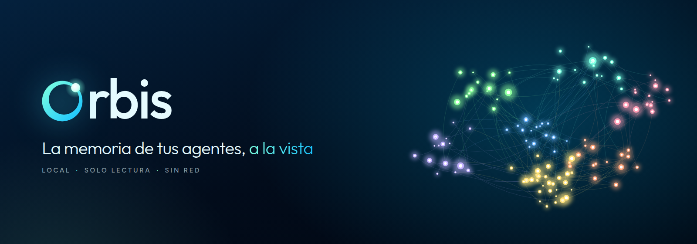
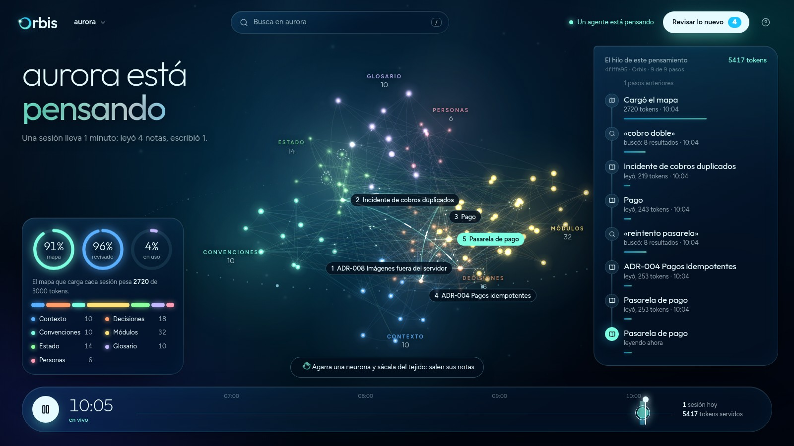
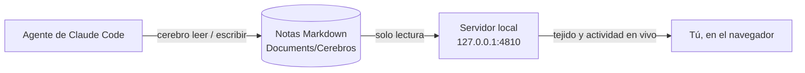
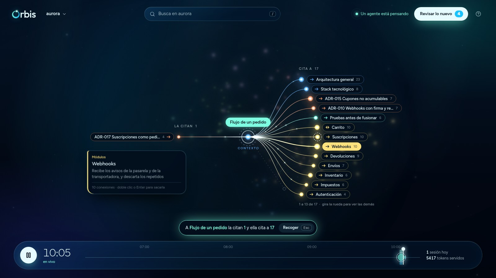
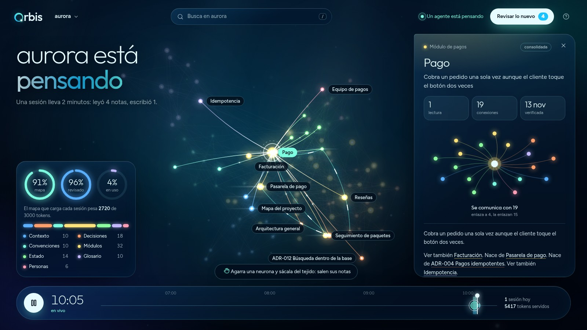
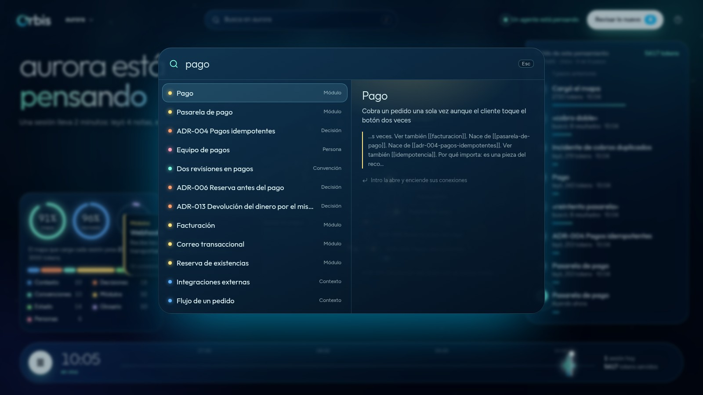

<p align="center">
  
</p>

<p align="center">
  <b>Tus agentes de Claude Code escriben y leen notas. Orbis te deja verlas pensar.</b><br>
  Un tejido vivo de neuronas conectadas, en tu equipo, sin nube y sin tocar una sola nota.
</p>

<p align="center">
  
  
  
  
  
</p>

<p align="center">
  <a href="#lo-que-ves">Lo que ves</a> ·
  <a href="#empezar">Empezar</a> ·
  <a href="#cómo-lo-usan-los-agentes">Para los agentes</a> ·
  <a href="#atajos">Atajos</a> ·
  <a href="#privacidad">Privacidad</a> ·
  <a href="#si-algo-falla">Si algo falla</a>
</p>



## Qué es

Orbis es una memoria a largo plazo para agentes de Claude Code, hecha de notas Markdown («cerebros») que viven en tu
equipo. Tiene **dos lectores** y a cada uno le da lo que necesita:

| | Cómo entra | Qué recibe |
|:--|:--|:--|
| **El agente** | El comando `cerebro`, desde Bash | Un mapa corto y solo las notas que pide. Gasta muy pocos tokens. |
| **Tú** | La app, en el navegador | El cerebro entero como un tejido: qué sabe, cómo se conecta y qué está leyendo ahora mismo. |



La app nunca escribe. Cuando decides algo desde ella (consolidar una nota, fusionar dos), copia una orden para que la
pegues en Claude Code, y es el agente quien la ejecuta.

## Lo que ves

### El tejido

Cada nota es una neurona y cada enlace `[[id]]`, una fibra. Los siete tipos de nota (contexto, decisiones,
convenciones, módulos, estado, glosario y personas) forman regiones con su color y su nombre.

- **Lo ves pensar.** Cuando un agente busca, lee o escribe, la neurona se enciende y lanza una onda. El titular dice
  si el cerebro está en calma o pensando, y a la derecha va el **hilo**: qué buscó, qué leyó, dónde no encontró nada
  y cuántos tokens le costó cada paso.
- **Signos vitales.** Cuánto del presupuesto ocupa el mapa, qué parte de las notas está revisada y qué parte se usa
  de verdad. Debajo, la composición por tipo: un clic deja encendido solo ese tipo.
- **La cinta del día.** Abajo, cada sesión de hoy es un tramo. Tócala y Orbis la repite paso a paso sobre el tejido.
- **Calma.** El tejido gira muy despacio (una vuelta cada cinco minutos) y se detiene en cuanto lo tocas.

### Sacar una neurona



Agarra cualquier neurona y jálala (o hazle doble clic): sale del tejido y **sus notas salen con ella**, ordenadas
como un diagrama. A la izquierda quedan las que la citan y a la derecha las que ella cita; la flecha doble marca las
que se citan mutuamente y el número, con cuántas notas se comunica cada una.

- **Camina el cerebro.** Doble clic en una de las notas que salieron y ella pasa al centro con las suyas. Arriba
  queda el camino recorrido, y cada paso es un botón para volver.
- **Sin ratón.** Flechas para recorrer, `Enter` para sacar la señalada, `Retroceso` para volver.
- **Sin límite.** Si una nota tiene más conexiones de las que caben, la rueda corre la lista.
- **Todo vuelve a su sitio** con `Esc`, con un clic en el fondo o con «Recoger».

### Leer una nota



Un clic abre la nota: la cámara vuela hasta ella, se encienden sus conexiones y el panel muestra su descripción,
cuántas veces la han leído los agentes, su vecindario y el contenido completo. Desde ahí puedes saltar a cualquier
vecina, copiar su enlace o copiar la orden para que Claude la lea.

### Buscar



`/` o `Ctrl K`. Busca como buscan los agentes: sin tildes y por raíz de palabra («cotizar» encuentra
«cotizaciones»). Mientras escribes, los resultados se encienden en el tejido.

### Revisar lo nuevo

Lo que escribe un agente queda marcado como **reciente** hasta que alguien lo revisa. El botón «Revisar lo nuevo»
(o la tecla `R`) las pone una por una sobre la mesa, junto a la nota que más se le parece, y cada decisión copia
la orden exacta para Claude Code.

> Las capturas son de «Tienda Aurora», un cerebro de ejemplo inventado para este README. Los tuyos viven en tu
> carpeta de documentos, nunca en este repositorio.

## Empezar

| Requisito | Detalle |
|:---|:---|
| Sistema | Windows 10 u 11 (el lanzador de doble clic es para Windows). |
| Node.js | **24 LTS o superior.** |
| Navegador | Edge o Chrome recientes. |
| Claude Code | Haberlo usado al menos una vez, para que exista la carpeta `.claude`. |

```powershell
git clone https://github.com/Yeisoncgy/Orbis
cd Orbis
npm install
```

Luego abre **`Abrir Orbis.cmd`** con doble clic. La primera vez compila la app sola y tarda un poco; después se
abre en segundos.

Eso basta para **ver** Orbis. Para que **tus agentes** usen los cerebros, falta este paso:

### Darle los cerebros a tus agentes

```powershell
npm run build
npm run instalar
```

- `npm run build` empaqueta la herramienta de línea de comandos en `dist/cerebro.mjs`.
- `npm run instalar` la copia a `~/.claude/cerebro/`, instala la skill `/cerebro` y agrega un bloque con marcas
  `<!-- cerebro:inicio -->` y `<!-- cerebro:fin -->` en tu `~/.claude/CLAUDE.md`. Se puede correr las veces que
  quieras: no duplica nada. Antes de tocar tu configuración guarda un respaldo
  (`settings.json.antes-de-cerebro`).
- Lo corres tú, no un agente: edita configuración de tu usuario.
- Dice dónde quedan los cerebros y el respaldo diario, y los deja escritos en `~/.claude/cerebro/config.json`. Para
  elegirlos: `npm run instalar -- --raiz "C:\Cerebros" --respaldo "E:\Respaldo-cerebros"`. Conviene que los cerebros
  no queden en una carpeta de OneDrive (se sincronizarían a la nube y el historial de git sufre) y que el respaldo
  vaya a otro disco.
- Para quitarlo: `npm run desinstalar`. Borra el CLI, la skill y el bloque de `CLAUDE.md`, y deja la memoria de Claude
  Code como estaba. No toca tus cerebros ni sus respaldos.

### Abrir Orbis cada día

Doble clic en **`Abrir Orbis.cmd`**. No abre ninguna ventana de terminal: en unos segundos Orbis aparece en el
navegador. Si ya estaba abierto, solo abre otra pestaña. **Se apaga sola 3 minutos después de cerrar la última
pestaña.** Si algo falla, un mensaje dice por qué.

La pestaña también te avisa: el título dice qué cerebro miras y cuántas notas hay por revisar, y mientras un agente
piensa, la neurona del icono da vueltas.

<details>
<summary><b>Tenerlo en el escritorio y en la barra de tareas</b></summary>

Crea un acceso directo (clic derecho en el escritorio > Nuevo > Acceso directo) con este destino, cambiando la
carpeta por la tuya:

```
wscript.exe "C:\ruta\a\Orbis\scripts\abrir-oculto.js"
```

En Propiedades > Cambiar icono elige `scripts\cerebro.ico`. Luego clic derecho en el acceso directo > Mostrar más
opciones > Anclar a la barra de tareas.

Para verlo con una consola (se apaga al cerrarla): `npm run app:abrir`.

</details>

## Cómo lo usan los agentes

Los agentes no necesitan Orbis abierto. Trabajan con el comando `cerebro` desde la herramienta Bash. Sin hooks ni MCP:
lo que los guía es la skill `/cerebro` y un bloque corto en `~/.claude/CLAUDE.md`.

| Comando | Para qué |
|:---|:---|
| `cerebro mapa <cerebro> [tema]` | Índice. Es lo primero que se lee. Si el cerebro es grande, es un índice por temas y cada tema se abre aparte. |
| `cerebro buscar <cerebro> <palabras>` | Notas por relevancia: sin tildes, por raíz de palabra («cotizar» encuentra «cotizaciones»), con `"frase exacta"`, `--tipo`, `--tag`, `--desde` y `--todos`. |
| `cerebro leer <cerebro> <id...>` | Notas completas con sus enlaces. `--breve` da solo la ficha; `--seccion "título"`, una parte. |
| `cerebro vecinos <cerebro> <id>` | Qué notas rodean a una, a 1, 2 o 3 saltos. |
| `cerebro escribir <cerebro>` | Crea o actualiza una nota (llega por la entrada estándar). |
| `cerebro cerrar <cerebro>` | Antes de terminar la sesión: qué vale la pena guardar, o varias notas de una vez. |
| `cerebro estado <cerebro> <estado> <id...>` | Marca notas como `reciente`, `consolidada` u `obsoleta`. |
| `cerebro consolidar <cerebro>` | Propone qué hacer con cada nota sin revisar: fusionar, dejar o resolver un choque. |
| `cerebro verificar <cerebro>` | Enlaces rotos, notas sin revisar, vencidas y costo del mapa. |

El resto (`podar`, `comprobar`, `metricas`, `evaluar`, `renombrar`, `historial`, `deshacer`, `respaldar`, `sembrar`,
`importar-obsidian`, `importar-memoria`) sale con `cerebro` sin argumentos.

Con `/cerebro guardar ...` el agente guarda lo aprendido, con `/cerebro consolidar` pasa lo reciente a largo plazo y
con `/cerebro sembrar` crea las primeras notas de un proyecto a partir de su documentación.

### El mapa tiene presupuesto

Cada cerebro genera un `MAPA.md`. Si el `CLAUDE.md` de tu proyecto lo importa con una línea `@`, el agente lo tiene en
contexto desde el primer mensaje, así que se paga en cada sesión. Por eso tiene un tope (3.000 tokens; se cambia con
`cerebro ajustar <cerebro> --presupuesto <n>`): mientras el cerebro quepa, el mapa lista todas las notas; cuando no,
pasa a ser un índice por temas con las notas más usadas, y el agente abre el tema que necesita.

### Cómo es una nota

```
---
titulo: Caché de consultas con vencimiento corto
tipo: decision
descripcion: Las consultas se guardan 10 minutos; reemplaza una caché sin vencimiento que servía datos viejos
tags: [rendimiento]
alias: [cache ttl]
fuente: [src/cache.ts]
valido_hasta: 2027-06-30
reemplaza: [cache-sin-vencimiento]
---
Qué se decidió, **por qué**, y enlaces a lo relacionado: [[servicio-de-consultas]].
```

- **Tipos:** `contexto`, `decision`, `convencion`, `modulo`, `estado`, `glosario` y `persona`.
- **Estados:** `reciente` (lo que escribe un agente: sin revisar), `consolidada` (revisada) y `obsoleta` (se oculta, nunca se borra).
- **Una idea por nota,** con el porqué, y enlazada con `[[id]]` a lo relacionado. La `descripcion` es lo que se ve
  en el mapa (hasta 140 caracteres; el CLI rechaza más de 200).
- **Opcionales:** `alias` (otras palabras con las que se buscaría), `fuente` (de dónde sale), `valido_desde` y
  `valido_hasta`, y los enlaces con significado `reemplaza`, `depende_de` y `contradice`. Para enlazar una nota de
  otro cerebro: `[[otro-cerebro:id]]`.
- El CLI anota solo quién la escribió (agente, persona o importación), en qué proyecto y cuándo se verificó.
- Las notas son archivos Markdown en `Documents\Cerebros\<cerebro>\notas\`, con un commit de git por nota si hay git.

### Una memoria que se cuida

- **Lo que no entra.** El CLI rechaza claves, tokens y contraseñas; no deja crear una nota con casi el mismo título
  que otra; y un título repetido no sobrescribe: para actualizar hay que decir el `id`. Avisa si la nota es casi toda
  código (eso ya lo dice el repositorio), si es larga o si se parece a otra.
- **Lo reciente no es de fiar hasta revisarlo.** Una nota que escribió un agente sale marcada en el mapa y, al leerla,
  avisa que hay que contrastarla. `cerebro consolidar` propone qué hacer con cada una.
- **Lo que envejece se nota.** Una nota vencida (`valido_hasta`) o que cita archivos que ya no existen
  (`cerebro comprobar <cerebro> <repo> --marcar`) queda marcada para revisar. `cerebro podar` lista lo que sobra.
- **Se puede medir.** `cerebro pregunta` arma un banco de preguntas con la nota que debería salir y `cerebro evaluar`
  dice en qué puesto sale; `cerebro metricas` muestra lo que se lee, lo que nadie lee y lo que se buscó sin encontrar.
- **Se puede deshacer.** `cerebro historial` y `cerebro deshacer` usan el git de cada cerebro. Además hay un respaldo
  diario automático de las notas en la carpeta de respaldos.
- **Varias sesiones a la vez.** Las escrituras de un cerebro van una por una, aunque haya varios agentes abiertos.

## Atajos

| Control | Qué hace |
|:---|:---|
| Arrastrar una neurona | La saca del tejido y salen sus notas: quién la cita y a quién cita. |
| Doble clic en una neurona | La saca sin arrastrarla. Sobre una nota que ya salió, sigue el camino por ella. |
| `↑` `↓` `←` `→` y `Enter` | Con una neurona fuera: recorre sus notas y saca la señalada. |
| `Retroceso` | Vuelve a la neurona anterior del camino. |
| Rueda sobre las notas | Si no caben todas, muestra las demás. |
| Clic en una neurona | Abre la nota y enciende sus conexiones. |
| Arrastrar el fondo | Gira el tejido. |
| Rueda | Acerca o aleja. |
| Doble clic en el fondo, o `0` | Vuelve a la vista completa. |
| `/` o `Ctrl K` | Buscar. |
| `R` | Revisar lo nuevo. |
| `Espacio` | Pausar o seguir en vivo. |
| `Esc` | Cierra lo que esté abierto o recoge la neurona sacada. |
| `?` | Muestra esta lista dentro de la app. |

Enlace directo a una nota: `http://127.0.0.1:4810/?cerebro=<nombre>&nota=<id>`.

## Privacidad

- Orbis solo escucha en `127.0.0.1` y solo acepta lecturas (`GET`): nadie más en la red puede entrar y la app no
  puede cambiar tus notas. También rechaza otros `Host`, para que una página web cualquiera no pueda leerlas.
- Tus cerebros viven en `Documents\Cerebros\` (o donde indique `CEREBRO_RAIZ`), **nunca dentro de este
  repositorio**. No los copies aquí.
- Orbis no registra qué miras tú: lo que mide (las neuronas que crecen, el porcentaje en uso) es solo lo que leen
  los agentes.
- No llama a ningún servicio externo ni usa tokens. Las letras y los iconos van dentro de la app.

## Si algo falla

- **Un mensaje dice que Orbis no pudo abrir.** Lo más común es que el puerto 4810 lo use otra aplicación. Cambia
  el puerto con la variable `CEREBRO_PUERTO` o ciérrala. Para ver el detalle, corre `npm run app:abrir`.
- **"No se pudo conectar con Orbis".** El servidor se apagó (por inactividad) o se cerró. Vuelve a abrirlo con
  `Abrir Orbis.cmd`.
- **"Aún no hay cerebros".** Crea el primero desde una sesión de Claude Code con `/cerebro nuevo`, o con
  `cerebro crear <nombre> "<descripción>"`.
- **«Otra sesión está escribiendo».** Otro agente tiene el cerebro ocupado; reintenta en unos segundos. Si nadie más
  lo usa, borra el archivo `.bloqueo` del cerebro.
- **El agente no encuentra una nota que existe.** Agrégale un `alias` con las palabras que usó, y esa pregunta al
  banco: `cerebro pregunta <cerebro> "<pregunta>" <id>`.
- **Se guardó algo que no debía.** `cerebro historial <cerebro>` y `cerebro deshacer <cerebro> <código>`.
- **Los agentes no usan los cerebros.** Corre `npm run build` y `npm run instalar`, y abre una sesión **nueva** de
  Claude Code. Con `cerebro listar` confirmas que ve tus cerebros.
- **Pantalla en blanco al desarrollar en Windows.** Si el directorio actual llega como `c:` y `C:` mezclados,
  Vite empaqueta React dos veces. `vite.config.ts` ya usa la ruta real y evita el problema.

## Desarrollo

```powershell
npm run typecheck
npm test
npm run build:app
```

`npm test` corre las pruebas del núcleo, del CLI y del servidor (41). Crean sus cerebros en carpetas temporales:
no tocan los tuyos.

```
Abrir Orbis.cmd     doble clic: abre la app sin ventana de terminal
core/               formato de nota, grafo, búsqueda, mapa, reglas de escritura, mantenimiento, importadores, git y actividad
cli/                el comando cerebro que usan los agentes (con sus pruebas)
skill/              la skill /cerebro que se instala en Claude Code
servidor/           servidor local de Orbis (solo lectura, solo 127.0.0.1, actividad en vivo; con sus pruebas)
app/                la app visual: React 19 y Vite 6
app/src/tejido/     el motor del tejido: lienzo 2D propio, con cámara, profundidad y física, sin librerías de grafos
scripts/            instalador, desinstalador, lanzador sin ventana, icono y pruebas del apagado automático
docs/               imágenes de este README
```

Tras cambiar `core/`, `cli/` o la skill: `npm run build` y `npm run instalar`. Tras cambiar `app/`:
`npm run build:app` (el servidor lee `dist/app` en cada pedido, no hace falta reiniciarlo). El icono y sus copias
se regeneran con `npm run icono`.

Fuera de Windows no hay lanzador, pero el servidor y el CLI corren igual con Node: `npm run build:app` y luego
`node servidor/servidor.ts`.
